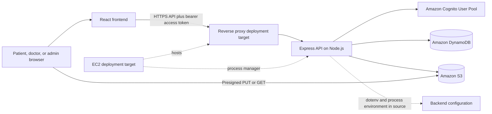

<div align="center">

# ☁️ MediCloud

### A healthcare appointment and medical document management platform

**Discover care · Manage appointments · Keep patient documents organized**

<br />


<br />

[Architecture](docs/ARCHITECTURE.md) · [Deployment guide](docs/DEPLOYMENT.md) · [AWS console guides](docs/aws/CONFIGURATION-REFERENCE.md) · [Vercel](docs/VERCEL.md) · [Troubleshooting](docs/TROUBLESHOOTING.md)

</div>

---

## 🩺 About MediCloud

MediCloud is a full-stack healthcare application for patients, doctors, and administrators. Patients can find doctors and specialties, manage appointments, and upload or retrieve their medical documents. Doctor and administrator areas provide role-specific appointment and directory workflows.

The project combines a React single-page frontend with a Node.js/Express API. Its adapters support local mock services for development and AWS-backed implementations for authentication, persistence, and object storage. The repository documents an implementation and a deployment approach; it does not establish clinical suitability, regulatory compliance, or the state of a live production service.

> **Privacy:** Use synthetic accounts and non-sensitive files during development and evaluation. Do not upload real patient information to an unverified deployment.

## ✨ What you can do

| Patient | Doctor | Administrator |
|---|---|---|
| Register, confirm email, sign in, and manage profile | View assigned appointments and patient schedules | Review platform appointment statistics and appointments |
| Browse doctors and specialties | Manage availability slots | Create and update doctor directory records |
| Book, reschedule, and cancel appointments | Update appointment status | Activate or deactivate doctor listings |
| Upload, list, download, and delete medical documents | | |

Additional implementation details:

- Cognito-mode authorization verifies access tokens and resolves roles from server-side profiles.
- DynamoDB mode stores application records in a single table and uses conditional transactions to reserve appointment slots.
- S3 mode sends document bytes directly from the browser with short-lived presigned URLs; the API stores upload intents and document metadata.
- Local mock adapters support auth, data, storage, and email without AWS resources. Mock data is in-memory and resets when the backend restarts.

## 🎬 See the application

The repository contains frontend screens under `frontend/src/pages/` for the landing page, sign-in and registration, patient, doctor, and administrator workflows. A live demo URL or preview image is not verified in this repository. The deployment context mentions a Vercel URL, but it has not been independently checked; see [deployment verification](docs/DEPLOYMENT.md).

## 🏗️ Architecture at a glance



The code confirms the React/Vite frontend, Express API, Cognito access-token verification, DynamoDB and S3 adapters, and direct browser-to-S3 transfer. Vercel, EC2, Nginx, PM2, and SSM Parameter Store are deployment context or targets: live service state is not verified, and no SSM loader, PM2 configuration, Nginx configuration, or TLS setup is present in this repository. See [architecture and data flows](docs/ARCHITECTURE.md).

## 🧰 Technology

| Layer | Technology |
|---|---|
| Frontend | React 19, Vite, React Router, Tailwind CSS, Framer Motion |
| API | Node.js ES modules, Express 4, Zod validation, Winston logging |
| Authentication | Amazon Cognito adapter with `aws-jwt-verify`; local mock adapter |
| Database | Amazon DynamoDB single-table repository; in-memory mock repository |
| Document storage | Amazon S3 and presigned URLs; local mock storage adapter |
| Email | Brevo adapter; local mock email adapter |
| Testing and tooling | Node test runner, Supertest, Vitest, Testing Library, oxlint |
| Deployment docs | Manual AWS/EC2 runbook; live deployment and automation are unverified |

Version ranges are recorded in the `frontend/package.json` and `backend/package.json` manifests and lockfiles. No CI/CD workflow is present in the repository inventory.

## 🚀 Quick start

### Prerequisites

- Git
- Node.js compatible with both package manifests and lockfiles (the backend README states Node 18+; check current Vite requirements for your selected Node release)
- npm
- AWS account and permissions only if you choose to activate real AWS adapters

### 1. Clone the repository

```bash
git clone <repository-url>
cd MediCloud
```

### 2. Install and start the backend

```bash
cd backend
cp .env.example .env
npm install
npm run dev
```

The local API listens on `http://localhost:5000` by default. Check `GET http://localhost:5000/api/health`.

### 3. Install and start the frontend

Open another terminal from the repository root:

```bash
cd frontend
cp .env.example .env.local
npm install
npm run dev
```

Vite serves the frontend at `http://localhost:5173`. The example frontend API base is `http://localhost:5000`. Both example configurations select mock providers, so no AWS credentials are required for local development.

### 4. Useful project commands

Run each command from its component directory:

| Directory | Command | Description |
|---|---|---|
| `backend/` | `npm run dev` | Start API with Nodemon |
| `backend/` | `npm start` | Start API with Node.js |
| `backend/` | `npm test` | Run Node test suite |
| `frontend/` | `npm run dev` | Start Vite development server |
| `frontend/` | `npm test` | Run Vitest suite |
| `frontend/` | `npm run lint` | Run oxlint |
| `frontend/` | `npm run build` | Build frontend assets |

## 🔐 Configuration

### Frontend variables

| Variable | Purpose | Local example |
|---|---|---|
| `VITE_API_URL` | Express API base URL; `/api` is appended by the client | `http://localhost:5000` |
| `VITE_APP_NAME` | Application display metadata | `MediCloud` |
| `VITE_APP_ENV` | Environment indicator used by the UI | `development` |

Set `VITE_API_URL` in the Vercel build environment only if deploying there, then rebuild/redeploy. Every `VITE_` value becomes browser-visible. Never put credentials, API keys, AWS keys, or Cognito client secrets in frontend variables.

### Backend variables

| Variable(s) | Purpose | Example / guidance |
|---|---|---|
| `NODE_ENV`, `PORT`, `FRONTEND_URL`, `FRONTEND_ORIGIN`, `LOG_LEVEL` | Runtime, listener, API CORS origin, log level | `development`, `5000`, `http://localhost:5173`, `info` |
| `DB_PROVIDER`, `AUTH_PROVIDER`, `STORAGE_PROVIDER`, `EMAIL_PROVIDER` | Select local or real adapters | Defaults are `mock`; real modes are `dynamodb`, `cognito`, `s3`, `brevo` |
| `AWS_REGION`, `DYNAMODB_TABLE_NAME` | AWS SDK region and table | Example file currently uses `ap-south-1` and `medicloud-local` |
| `COGNITO_USER_POOL_ID`, `COGNITO_CLIENT_ID` | Cognito pool and app client | Backend only; use identifiers for the selected region |
| `COGNITO_CLIENT_SECRET` | Secret hash for current Cognito adapter | Backend secret store only; required by current Cognito-mode validator |
| `COGNITO_DOMAIN` | Optional config field | No usage was found in the current frontend/API flow |
| `S3_BUCKET_NAME` | S3 adapter bucket | Example file suggests `medicloud-medical-files-0234`; verify region/name |
| `BREVO_API_KEY`, `BREVO_SENDER_EMAIL`, `BREVO_SENDER_NAME` | Email adapter configuration | Store API key in backend-only secret configuration |

The checked-in backend example uses `ap-south-1`, while deployment context supplied for this project mentions `eu-north-1`. Choose and verify the actual region and resource settings before enabling AWS providers. `backend/src/config/env.js` loads a local `.env`; AWS SDK clients use the default credential provider chain. Although the supplied context mentions SSM Parameter Store, no SSM loader is implemented in the checked-in code. See [deployment configuration](docs/DEPLOYMENT.md).

## 🔌 API reference

Routes below are mounted under `/api`. “Bearer” means the request must include an authenticated access token; controller/service logic may apply additional ownership checks.

| Method | Endpoint | Access | Description |
|---|---|---|---|
| `GET` | `/health` | Public | Service health check |
| `POST` | `/auth/register` | Public | Register patient account |
| `POST` | `/auth/confirm` | Public | Confirm registration code |
| `POST` | `/auth/resend-confirmation` | Public, rate limited | Request another confirmation code |
| `POST` | `/auth/login` | Public | Sign in and receive an access token |
| `GET`, `PUT` | `/auth/me` | Bearer | Read or update own profile |
| `POST` | `/auth/logout` | Bearer | Cognito global sign-out in Cognito mode |
| `GET` | `/doctors`, `/doctors/:id`, `/doctors/specialties` | Public | Browse doctors and specialties |
| `POST`, `PUT`, `PATCH` | `/doctors/*` | Admin; slots also doctor | Create/update doctors, status, and availability |
| `POST` | `/appointments` | Patient | Book an appointment |
| `GET` | `/appointments/me` | Patient | List own appointments |
| `GET` | `/appointments/doctor/:doctorId` | Doctor/admin | List doctor's appointments |
| `PATCH` | `/appointments/:id/cancel`, `/appointments/:id/reschedule` | Bearer; ownership/role checked | Change appointment |
| `PATCH` | `/appointments/:id/status` | Doctor/admin | Update appointment status |
| `GET` | `/admin/stats`, `/admin/appointments`, `/admin/doctors` | Admin | Admin dashboards and lists |
| `POST`, `PATCH` | `/admin/doctors` and `/admin/doctors/:id/status` | Admin | Admin doctor management |
| `GET` | `/documents` | Bearer; own records | List own document metadata |
| `POST` | `/documents/upload-url` | Bearer | Create upload intent and return URL |
| `POST` | `/documents/confirm-upload` | Bearer | Verify S3 object and persist metadata |
| `DELETE` | `/documents/upload-intent/:uploadId` | Bearer; own intent | Cancel pending upload |
| `GET` | `/documents/:id/download-url` | Bearer; own document | Return temporary download URL |
| `DELETE` | `/documents/:id` | Bearer; own document | Delete S3 object and soft-delete metadata |

## 📁 Project layout

```text
MediCloud/
├── backend/
│   ├── src/
│   │   ├── adapters/       # Cognito/mock auth, S3/mock storage, Brevo/mock email
│   │   ├── config/         # Environment configuration and DynamoDB schema
│   │   ├── controllers/    # HTTP request handlers
│   │   ├── middleware/     # Auth, rate limits, request logging, errors
│   │   ├── repository/     # DynamoDB and in-memory repositories
│   │   ├── routes/         # API routes
│   │   ├── services/       # Appointment, document, doctor, auth workflows
│   │   └── validators/     # Environment validation
│   ├── tests/              # Node test-runner tests
│   ├── server.js
│   └── package.json
├── frontend/
│   ├── src/
│   │   ├── components/     # Shared UI and booking components
│   │   ├── context/        # Application state
│   │   ├── pages/          # Landing, auth, patient, doctor, admin pages
│   │   ├── layouts/        # Main and dashboard layouts
│   │   └── utils/          # API client and formatters
│   ├── vite.config.js
│   └── package.json
├── docs/                   # Architecture, AWS, deployment and operations guides
└── README.md
```

## ☁️ AWS integration notes

The AWS adapters are optional and do not provision AWS resources automatically. Before switching providers, create the table, indexes, pool/client, bucket, CORS policy, and least-privilege runtime role described in the [AWS setup guide](docs/DEPLOYMENT.md).

- **Cognito:** Backend-mediated registration and login. The API verifies access tokens and derives roles from backend profiles.
- **DynamoDB:** Single-table storage using `PK` and `SK`, with GSI1, GSI2, and GSI3. See [table design](docs/aws/DYNAMODB.md).
- **S3:** Private document workflow using direct browser upload and short-lived presigned URLs. See [bucket setup](docs/aws/S3.md).
- **IAM:** Use temporary instance-role credentials and least-privilege actions. See [IAM guide](docs/aws/IAM.md).

Deployment identifiers and service state supplied outside the source have not been independently verified. For example, the code defaults and deployment context currently disagree on region. Do not treat a bucket name, IP address, user-pool ID, or role name as proof that the resource exists or is configured correctly.

## 🛡️ Security and privacy

- Cognito-mode routes verify access tokens; server-side profile data controls roles.
- Document metadata operations are scoped to the authenticated user. Signed URLs are bearer credentials; source expiry is 15 minutes for upload and 5 minutes for download.
- S3 keys are generated by the server and uploads are limited by declared MIME type and size. The current code does not inspect file bytes for content type.
- The S3 adapter requests AES-256 server-side encryption, but bucket policy/default encryption and actual deployment settings require AWS-side verification.
- Deletion first calls S3 `DeleteObject`, then marks the DynamoDB metadata item deleted. These operations can become inconsistent if one succeeds and the next fails.
- Backend API CORS is configured in Express. S3 browser CORS is separate and is not defined in the repository.
- No HIPAA or other compliance status is claimed. Review [security and privacy guidance](docs/SECURITY.md) before handling sensitive data.

## 🧭 Roadmap and contributions

Practical follow-up work based on current repository gaps:

- Reconcile deployment region and actual AWS resource identifiers.
- Add infrastructure-as-code and automated deployment only after reviewing the target environment and access model.
- Verify S3 CORS, encryption, IAM permissions, backups, TLS renewal, and runtime health checks in AWS.
- Add deployment-level observability and recovery procedures, including reconciliation for partial document deletion failures.
- Consider byte-level file validation and a documented retention policy for medical documents.

Contributions should include a clear problem statement, reproduction steps, and focused changes. Run relevant backend/frontend checks before opening a pull request. Do not attach secrets, presigned URLs, credentials, or real patient data to issues or pull requests.

## 🪪 License

No license file is present in the repository. No license has been specified.

## 📚 Documentation

Start at the [documentation index](docs/README.md) for architecture, IAM, Cognito, S3, DynamoDB, EC2, Parameter Store, HTTPS, Vercel, deployment, security, and troubleshooting guides. The [consolidated configuration reference](docs/aws/CONFIGURATION-REFERENCE.md) tracks each setting's evidence status. The existing [manual AWS and EC2 runbook](docs/manual-aws-and-ec2.md) is retained as preparation guidance; it does not verify a live deployment.
