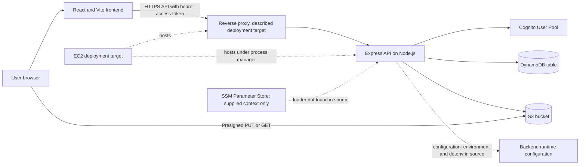
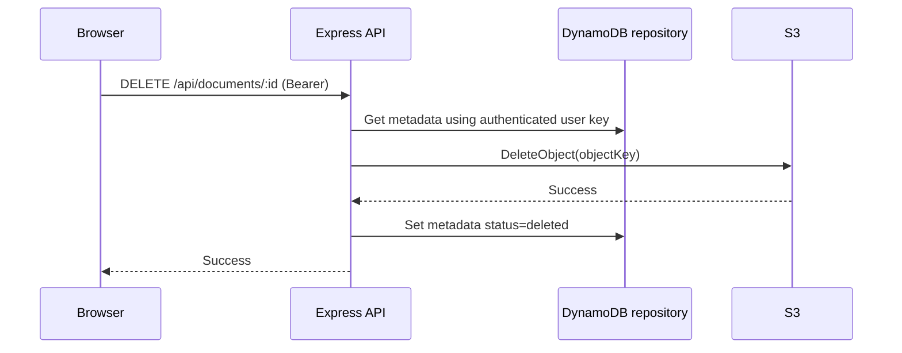

# MediCloud architecture

This document separates source-confirmed behavior from the deployment topology described by the existing runbook and supplied deployment context. AWS resources and live endpoints have not been inspected.

## Topology



Vercel, EC2, Nginx, and PM2 are described by deployment context/runbook, but this repository contains no Vercel project configuration beyond `frontend/vercel.json`, no Nginx or PM2 configuration, and no proof of running resources. `backend/src/config/env.js` loads `.env`; there is no SSM SDK integration found.

## Responsibilities and trust boundaries

- **Browser/frontend:** React UI; sends API requests to `VITE_API_URL`, attaches a bearer access token from `sessionStorage`, and uploads file bytes directly to S3 when using the real adapter.
- **Express API:** validates inputs, enforces authentication and role/ownership checks, coordinates repository/storage/email adapters, and returns response envelopes. Express CORS controls browser access to the API.
- **Cognito:** account registration, confirmation, password authentication, and access token issuer in Cognito mode.
- **DynamoDB:** profiles, doctor/specialty records, appointments, slot reservations, document metadata, and pending upload intents in the real repository.
- **S3:** document bytes. The adapter signs upload/download requests and uses server-side AWS credentials for head/delete operations.
- **Runtime credentials:** AWS SDK clients use the SDK credential chain. An EC2 role is recommended by the runbook, but actual role attachment is unverified.

Browser-to-API, browser-to-S3, API-to-AWS services, and the EC2 host boundary have different trust and permissions. S3 CORS permits a browser origin to make selected cross-origin requests; it does not grant S3 permissions.

## Authentication sequence

```mermaid
sequenceDiagram
  participant U as User
  participant F as Frontend
  participant API as Express API
  participant C as Cognito
  participant DB as Repository
  U->>F: Submit registration or credentials
  F->>API: POST /api/auth/register or /login
  API->>C: SignUp for registration, USER_PASSWORD_AUTH for login
  C-->>API: Confirmation state or access token
  API->>C: GetUser(access token) after login
  C-->>API: Verified subject and attributes
  API->>DB: Load/create profile; role is server controlled
  API-->>F: Login response with access token and profile
  F->>F: Store token in sessionStorage
  F->>API: Protected request with Authorization: Bearer
  API->>API: Verify token signature, issuer, expiry, pool, tokenUse=access
  API->>DB: Resolve profile and role
  API-->>F: Authorized result or 401/403
```

The flow is source-derived from `cognito-auth.adapter.js`, `middleware/auth.js`, and `frontend/src/utils/api.js`. No automatic token refresh flow was found; the access token is held in tab-scoped session storage and removed on a 401/logout handling.

## Document upload sequence

```mermaid
sequenceDiagram
  participant B as Browser
  participant API as Express API
  participant DB as DynamoDB repository
  participant S3 as S3
  B->>API: POST /api/documents/upload-url (Bearer, file metadata)
  API->>API: Validate MIME type, size, authenticated user
  API->>S3: Sign PUT for generated owner-scoped key
  API->>DB: Store expiring upload intent
  API-->>B: Presigned URL and uploadId
  B->>S3: CORS preflight, then PUT bytes with signed headers
  S3-->>B: Upload result
  B->>API: POST /api/documents/confirm-upload (uploadId)
  API->>DB: Read owner-scoped intent
  API->>S3: HeadObject; compare type and length
  API->>DB: Transactionally create metadata and consume intent
  API-->>B: Document metadata
```

The actual key pattern is `medical-records/<userId>/<uuid>-<sanitized-filename>`. PUT signs content type, content length, and `AES256` server-side-encryption request. Browser code sends `Content-Type` and `x-amz-server-side-encryption`. Confirmation checks the stored intent, object existence, reported type and size, then saves metadata.

## Document deletion sequence



Deletion is not a distributed transaction. If S3 deletion succeeds and metadata update fails, metadata can remain visible while the object is gone. If S3 deletion fails, metadata remains. Reconcile the object and metadata by document ID using restricted operator access.

## Persistence and failure handling

The DynamoDB schema is a single table with `PK`/`SK` and three GSIs. Repository queries paginate using `LastEvaluatedKey`. Appointment creation and rescheduling use transactional writes for slot claims. Upload intent completion transactionally creates metadata and deletes the intent. Document deletion is a separate S3 delete followed by a metadata soft delete.

The centralized Express error handler and async route wrapper serialize errors; request logging adds correlation IDs. Logs are structured and include redaction filters for common secret-like fields, but operators still need to avoid recording health information or signed URLs.

## Scaling and reliability considerations

No live capacity, availability, backup, or recovery properties are verified. DynamoDB uses paginated queries and transactional writes in the real adapter; index definitions must match `backend/src/config/dynamo-schema.md`. The mock repository is process memory and unsuitable for multi-process persistence. A single EC2 deployment would remain a single-host failure domain unless separately made redundant. Establish backup/restore tests, alerting, certificate renewal, capacity monitoring, and a deployment rollback procedure before relying on a live service.
